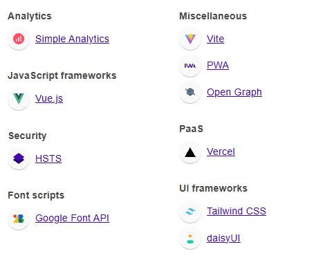
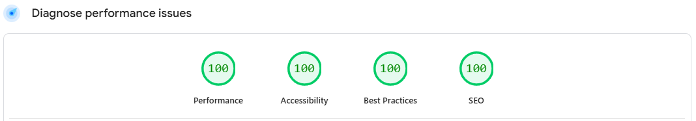

# Vue 3 + Vite Starter Template

This template is a solid foundation to build Vue 3 apps quickly using Vite. It includes:

* **Vue 3** with `<script setup>` SFCs for a clean and modern syntax.
* **Vite** for lightning-fast dev server and build.
* **Vitest** for components unit testing (the official Vitest).
* **Vue-I18n** for components Localization (the official).
* **Tailwind CSS** + **DaisyUI** for utility-first styling and prebuilt UI components.
* **Pinia** for state management (the official Vue store).
* **Vue Router** for SPA routing with dynamic routes and navigation guards.
* **PWA** support with installable app capabilities for a native-like experience.
* **ESLint** configured for consistent code style and quality.
* **Husky** with pre-commit hooks for automated code linting and unit testing.
* **Bundle Analyzer** for inspecting and optimizing bundle size.
* **SEO** automatically generating a sitemap.xml, helping search engines crawl site routes efficiently.
* A restrained, **minimal design system** with shared color tokens, quiet link tones, responsive layout and reduced-motion support.

---

## Getting Started

### Prerequisites

* Node.js & npm

### Install dependencies

```bash
npm install
```

### Run development server

```bash
npm run dev
```

Open your browser to start coding.

### Build for production

```bash
npm run build
```

### Run the full check (lint + tests)

```bash
npm run check
```

### Update Packages version

```bash
npx npm-check-updates --interactive
```

---

## Design system

The UI is intentionally minimal. Shared tokens and link tones live in `src/assets/base.css`:

* Palette: `--color-canvas`, `--color-ink`, `--color-muted`, `--color-line`, `--color-brand`, with dark-theme overrides. (`--color-accent` is reserved by DaisyUI.)
* Type: Tailwind's default sans throughout — no custom display faces or wide letter spacing.
* Links: `.app-link` for general links (muted, ink on hover) and `.active-route` for the exact active route (accent and underlined).
* Layout: centered `max-w-4xl` content, generous whitespace, thin dividers; no cards, shadows or color blocks.
* Motion: one short page-load fade via `BaseFade`, disabled under `prefers-reduced-motion`.
* Theme: the saved light/dark choice is applied at bootstrap, so even the 404 page keeps your selected theme.

The home page renders its tech inventory with `ToolsList.vue`; the counter page and 404 follow the same visual language. See `AGENTS.md` for the full conventions.

---

## Agent skills

Skills are installed **project-locally only**, so nothing is added to your user profile:

* `.agents/skills/frontend-design` — installed via the skills CLI; local-only and gitignored.

To add another skill from the project root, use project scope (no `-g`):

```bash
npx skills add <source> --skill <name> -a opencode -y
```

---

## Tech


---

## Performance


---

## Contributing
Feel free to open issues or pull requests to improve the template! Run `npm run check` before committing — the Husky pre-commit hook runs the same gate.
